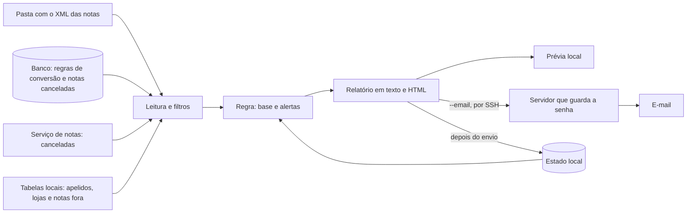

# alerta-preco-nfe

Relatório semanal dos itens que subiram de preço, calculado a partir do XML das notas fiscais eletrônicas (NF-e) de entrada. Escrito em
Python, usando só a biblioteca padrão.

## O problema

Quem compra de muitos fornecedores não percebe um aumento pequeno no meio de centenas de itens: a nota é conferida, e o preço novo vira o
normal sem que ninguém decida isso. Comparar o preço nota a nota também não resolve, porque o preço do item varia por rateio de boleto, por
troca de fornecedor e por erro de digitação, e a lista de avisos falsos logo deixa de ser lida.

Este programa lê as notas da semana anterior, compara cada item com as compras anteriores do mesmo produto e manda um único e-mail com o que
subiu de verdade, na segunda de manhã. A conta é sempre a mesma, sem modelo de linguagem: o mesmo conjunto de notas dá o mesmo relatório.

## Como funciona



Um item vira alerta quando sobe 5% ou mais em relação à mediana das 4 compras anteriores **e** a alta soma R$ 20,00 ou mais na semana. A nota
cujo boleto não bate com os itens fica fora do cálculo, porque o rateio criaria um preço falso. Produto novo é comparado com a matéria-prima
que ele substitui e aparece à parte, como troca. A regra completa, com exemplos, está em [`docs/regra.md`](docs/regra.md), e os módulos e o
motivo de cada escolha, em [`docs/arquitetura.md`](docs/arquitetura.md).

## Instalação

Precisa do Python 3.12 ou mais novo. Para enviar o e-mail, precisa também do cliente `ssh`, com acesso por chave ao servidor. Não há
dependências para instalar:

```
git clone https://github.com/cesaraaugustoo/alerta-preco-nfe.git
cd alerta-preco-nfe
python -m unittest discover -s tests -t .
```

## Configuração

Copie [`config.example.toml`](config.example.toml) para `~/alerta-preco/config.toml` e preencha:

| Campo | O que é |
|---|---|
| `fornecedores_boleto_conhecido` | Fornecedores cujo boleto difere dos itens de forma permanente. A nota fica fora do cálculo e vira só uma contagem no rodapé |
| `fontes.pasta_notas` | Pasta com o XML das notas, em subpastas por ano |
| `fontes.pasta_negocio` | Pasta com as tabelas em Markdown: `01-empresa.md`, `11-apelidos-fornecedores.md` e `15-notas-fora-do-balanco.md` |
| `fontes.arquivo_env` | Arquivo com `VITE_SUPABASE_URL` e `SUPABASE_SERVICE_ROLE_KEY`, usados só para leitura |
| `envio.vps_ssh` | `usuário@servidor` que envia o e-mail |
| `envio.arquivo_env_remoto` | Caminho, no servidor, do arquivo com `ALERTA_EMAIL_PARA`, `ALERTA_SMTP_USUARIO` e `ALERTA_SMTP_SENHA` |
| `envio.destinatarios_extras` | Quem recebe o relatório além de `ALERTA_EMAIL_PARA` |

O estado e as prévias também ficam em `~/alerta-preco`, fora do repositório.

## Uso

Rode de dentro do repositório:

```
python -m alerta_preco                                   ensaio da semana passada: mostra e salva a prévia, sem enviar
python -m alerta_preco --semana 2026-10-12               ensaio da semana desse dia
python -m alerta_preco --simular 2026-09-07 2026-10-30   repete as rodadas do período, sem serviço de notas, estado ou e-mail
python -m alerta_preco --conferir-leitura ARQUIVO.json   compara a leitura com a saída do leitor em JavaScript
python -m alerta_preco --email --teste                   manda só para ALERTA_EMAIL_PARA, marcado como teste, sem gravar estado
python -m alerta_preco --email                           a rodada de verdade
python -m alerta_preco --email --reenviar                manda de novo uma semana já enviada
```

Sem `--email`, nada é enviado. O código de saída é 0 quando deu certo, inclusive se a semana já tinha sido enviada, e 1 quando houve qualquer
problema. Com `--email`, o problema também gera um aviso na tela do Windows, e o relatório fica salvo na prévia quando o que falhou foi o envio.

O programa prefere não mandar e-mail a mandar um enganoso. Se faltar a pasta de um ano, se algum arquivo não abrir ou se não houver nenhuma nota
na semana, a rodada para. Arquivo de NF-e cortado antes do fim fica fora da conta e aparece no e-mail, para ser baixado de novo.

Para a rotina semanal, agende `python -m alerta_preco --email` para rodar toda segunda, com o repositório como pasta de trabalho.

## Segurança

O programa só lê: consulta o banco e o serviço de notas com `GET` e nunca escreve na pasta de notas. A senha do e-mail não sai do servidor, e as
mensagens de erro não trazem chave, token nem senha. Nenhum dado real entra neste repositório: os testes usam só dados inventados, e duas
varreduras conferem isso antes de cada envio. Detalhes em [`SECURITY.md`](SECURITY.md).

## Limites

- Só enxerga compra com nota: item sem NF-e não aparece.
- Só avisa alta. Queda de preço e aumento lento, abaixo do limite a cada compra, não geram alerta.
- No começo, a base tem poucas compras, e a mediana é menos estável. Ela melhora sozinha com o tempo.
- Produto novo sem regra de conversão, ou cujo código já foi comprado em outra unidade, não tem base e só entra na contagem de "sem base" do
  rodapé.
- O endereço recusado na hora do envio é avisado. A recusa que chega depois, por e-mail de devolução, o programa não enxerga.
- A nota que chega à pasta depois da rodada é avaliada na semana seguinte, até 14 dias depois.
- A leitura do XML usa expressões regulares de propósito, para dar a mesma conta do leitor em JavaScript que ela acompanha. Não é um leitor geral
  de NF-e.

## Desenvolvimento

O CI roda os testes no Windows e no Ubuntu, do Python 3.12 ao 3.14, e exige 90% de cobertura nos módulos da conta, `ruff` e `mypy --strict`
limpos. Essas ferramentas só são necessárias no CI. As mudanças estão em [`CHANGELOG.md`](CHANGELOG.md).

## Licença

Todos os direitos reservados: o código está visível para leitura, sem licença de uso. Veja [`LICENSE`](LICENSE).
